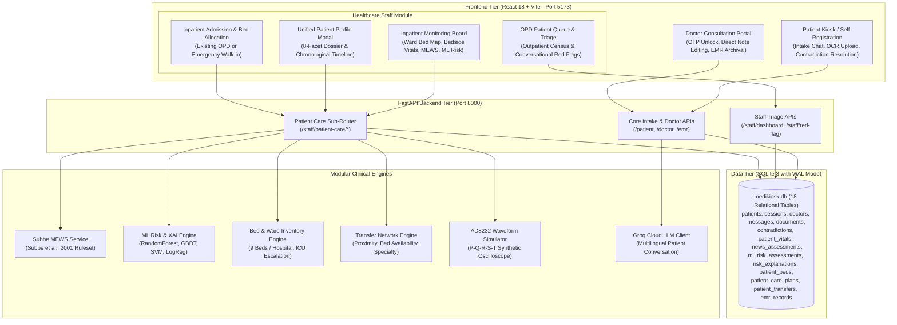

# MediKiosk + Patient Care
### AI-Powered Clinical Intake, Triage & Inpatient Physiological Monitoring Platform

[](#)
[-success)](#)
[](#)
[](#)
[](#)
[-003B57.svg)](#)
[](#)

---

## 📌 Executive Summary

**MediKiosk** is a next-generation clinical intake, triage, and inpatient healthcare platform engineered to bridge outpatient self-service intake with continuous inpatient physiological monitoring.

Originally built as an AI-powered multilingual intake kiosk with Groq LLM conversations, medical document OCR, contradiction detection, and doctor consultation workflows, MediKiosk now natively integrates comprehensive **Patient Care** inpatient capabilities inside the Healthcare Staff Module.

The platform provides a unified patient journey—from kiosk self-registration and symptom intake to bedside vital signs recording, Subbe 2001 MEWS early warning scoring, machine learning-driven deterioration risk prediction with Explainable AI (XAI), ward bed and ICU allocation, personalized care plans, and inter-hospital transfer coordination.

---

## 🏛️ System Architecture



---

## ✨ Key Capabilities & Workstations

### 1. 🏥 Patient Intake Kiosk (`/`)
- **Self-Registration & Authentication:** Generates unique `PAT-XXXXXXXX` identity; password-secured with salted SHA-256 hashes.
- **Multilingual AI Clinical Intake:** Groq LLM-driven structured medical interview capturing chief complaint, symptom onset, pain severity, and duration.
- **Conversational Red Alert Detection:** Real-time extraction of acute emergencies (e.g. crushing retrosternal pain, syncope, dyspnea) flagging `sessions.red_flag = 1`.
- **Medical Document Upload & OCR:** Upload lab reports or discharge summaries with character-level text extraction via Tesseract OCR.
- **Contradiction Detection Engine:** Highlights discrepancies between uploaded records and conversational answers (e.g. penicillin allergy vs intake denial) and prompts patient clarification.
- **Encounter Security:** Issues a 6-digit OTP code safeguarding patient summary unlock in doctor consultation.

### 2. 📋 Healthcare Staff Workstation (`StaffPortal.jsx`)
Features a persistent top workstation switcher toggling between Outpatient Triage and Inpatient Care:

#### View A: OPD Patient Queue & Triage
- **Hospital Census Dashboard:** Real-time counters for patients *In Process*, *Ready for Doctor*, *In Consultation*, *Completed*, and *Active Red Flags*.
- **Alert Acknowledgement:** Triage nurses acknowledge conversational red flags without erasing the clinical warning for attending physicians.

#### View B: Inpatient Care & Physiological Monitoring
- **Interactive Ward Bed Map:** Real-time visual cards for all 9 ward beds (2 ICU + 7 General Beds) showing patient occupancy, latest vitals, and MEWS scores.
- **Admission & Bed Allocation:**
  - *Admit Existing Patient:* Select from hospital queue and allocate a vacant bed.
  - *Emergency Walk-in:* Quick-register and allocate bed in one step.
  - *Vacant Bed Click:* Click `➕ Allocate Bed` directly on any vacant bed card.
- **Bedside Vital Signs Recording:** Input HR, BP, RR, Temp, SpO₂ with observation source attribution (`bedside_manual`, `ad8232_simulation`, `iot_monitor`, Rule 10).
- **Subbe MEWS (2001) Ruleset:** Automated 5-parameter calculation with exact score breakdown and zero false positives on normal heart rates (51–100 bpm = 0).
- **Discharge Safety Gate:** Blocks discharge for patients with MEWS >= 3 without explicit clinical supervisor override.
- **ML Deterioration Risk & Explainable AI (XAI):** Inference across 4 pre-trained models with human-readable feature attribution and deterministic fallback.
- **Simulated AD8232 ECG Oscilloscope:** 60-second real-time canvas waveform generator with BPM telemetry.
- **Personalized Care Plans:** Structured nursing care instructions, medication schedules, and dietary restrictions.
- **Inter-Hospital Transfers:** Multi-factor ranking engine matching destination hospitals by distance, available ICU beds, and medical specialty.

### 3. 📋 8-Facet Unified Patient Dossier (`UnifiedPatientProfileModal.jsx`)
One-click access from any patient row or bed card aggregates:
1. **Demographics & Registration**
2. **Clinical Intake Sessions & Chat Transcripts**
3. **Medical Documents & Extracted OCR Text**
4. **Clinical Contradictions & Patient Clarifications**
5. **Bedside Vital Signs Observation History**
6. **Subbe MEWS Early Warning Scoring Audit Trail**
7. **ML Deterioration Predictions & Explainable AI (XAI)**
8. **Chronological Multi-Source Timeline** (multi-provenance with staff actor attribution)

### 4. 🩺 Doctor Consultation Portal (`DoctorPortal.jsx`)
- **OTP Physical Verification:** Doctor enters patient's 6-digit OTP code to unlock consultation notes and documents.
- **Zero-AI Overwrite Clinical Authority:** Doctors review AI drafts and modify examination notes, diagnoses, and prescriptions directly. External LLMs are never allowed to overwrite physician notes.
- **Hospital EMR Archival:** Finalized encounters commit immutable records into `emr_records`.

---

## ⚡ Decoupled Dual-Alert Architecture (Rule 9)

A strict clinical separation is enforced between **Conversational Red Flags** and **Physiological MEWS Deterioration Alerts**:

| Clinical Dimension | Alert A: Conversational Red Flag | Alert B: Physiological MEWS Alert |
| :--- | :--- | :--- |
| **Originating Trigger** | Emergency symptoms in kiosk chat | Bedside vital observation MEWS >= 4 |
| **Database Storage** | `sessions.red_flag` | `patient_vitals.mews_score` |
| **Clinical Domain** | Outpatient triage | Inpatient ward monitoring |
| **Visual Badge** | Crimson Badge (`🚨 AI Chat Red Flag`) | Amber/Red Badge (`⚡ MEWS Alert`) |
| **Staff Resolution** | Staff Portal Acknowledge button | Bedside vital re-assessment |
| **Decoupling Rule** | Acknowledging chat flag **never** modifies vital signs. | Recording normal vitals **never** dismisses conversational red flags. |

---

## 🚀 Quickstart & Installation Guide

### Prerequisites
- **Python 3.10 to 3.13**
- **Node.js 18+ & npm 9+**
- **Tesseract OCR** (Optional, for image text extraction)

### 1. Backend Setup
```bash
# Navigate to backend
cd backend

# Create & activate virtual environment
python -m venv .venv
# Windows (PowerShell):
.\.venv\Scripts\Activate.ps1
# Linux / macOS:
source .venv/bin/activate

# Install dependencies
pip install -r requirements.txt

# Configure environment variables
# Copy .env.example to .env and configure your Groq API key:
cp .env.example .env

# Initialize / verify database tables
python -c "import database; database.init_db(); print('Database initialized!')"

# Start FastAPI backend
uvicorn app.main:app --host 127.0.0.1 --port 8000 --reload
```
*Backend verification:*
- OpenAPI Interactive Documentation: **`http://127.0.0.1:8000/docs`**

### 2. Frontend Setup
```bash
# In a new terminal, navigate to frontend
cd Frontend

# Install dependencies
npm install

# Configure environment variables
cp .env.example .env

# Build production bundle
npm run build

# Start Vite development server
npm run dev
```
*Frontend verification:*
- Web Application: **`http://localhost:5173`**

---

## 🔑 Default Demonstration Credentials

The application includes 3 pre-seeded hospitals and staff accounts:

| Hospital Facility | Staff Email | Password | Facility ID |
| :--- | :--- | :--- | :--- |
| **MediKiosk General Hospital** | `staff@medikiosk.com` | `password123` | `hosp-medikiosk` |
| **Apollo Clinic & Tertiary Care** | `staff@apollo.com` | `password123` | `hosp-apollo` |
| **City Diagnostics & Specialty** | `staff@city.com` | `password123` | `hosp-city` |

*Doctor Portal:* Select attending doctor from the dropdown (e.g. `Dr. Rajesh Gupta - Cardiology` or `Dr. Priya Sharma - General Medicine`).

---

## 🧪 Comprehensive Automated Test Suites

The repository contains 6 comprehensive automated test suites covering 131 test cases with a **100% pass rate**:

```bash
cd backend

# 1. Baseline MediKiosk regressions (10 tests)
python test_new_features.py

# 2. Inpatient capabilities: Vitals, MEWS, ML risk, beds, transfers (42 tests)
python test_patient_care_backend.py

# 3. Healthcare Staff Dashboard UI contracts (12 tests)
python test_phase3_staff_dashboard.py

# 4. Unified patient data dossier & chronological timeline (28 tests)
python test_phase4_patient_data_integration.py

# 5. Master comprehensive validation suite - Categories A to I (38 tests)
python -m unittest test_phase5_comprehensive_validation.py

# 6. Database WAL online backup & isolated restore verification (1 test)
python test_backup_restore.py
```

---

## 📁 Repository Directory Structure

```
Medikiosk/
├── backend/                              # FastAPI Backend Service
│   ├── app/
│   │   ├── main.py                       # Application entrypoint & route registration
│   │   ├── models/                       # Pydantic schemas (patient_care_models.py)
│   │   ├── routers/                      # Route controllers (patient_care.py)
│   │   └── services/patient_care/        # Inpatient services (mews, ml_risk, transfer, ecg)
│   ├── database.py                       # SQLite data access engine & schemas
│   ├── medikiosk.db                      # Primary database (SQLite WAL mode)
│   ├── requirements.txt                  # Python dependencies
│   ├── .env.example                      # Backend environment template
│   └── test_*.py                         # Automated test suites
├── Frontend/                             # React 18 + Vite User Interface
│   ├── src/
│   │   ├── App.jsx                       # Main UI router & portal navigation
│   │   ├── components/                   # StaffPortal.jsx, DoctorPortal.jsx, Kiosk components
│   │   └── components/patient_care/      # Inpatient monitoring module & modal suite
│   ├── package.json                      # Frontend dependencies & scripts
│   └── .env.example                      # Frontend environment template
├── docs/                                 # Complete Technical & Clinical Documentation
│   ├── FINAL_SYSTEM_ARCHITECTURE.md      # System architecture & ER diagram
│   ├── INSTALLATION_AND_SETUP.md         # Detailed installation guide
│   ├── API_DOCUMENTATION.md              # REST API reference documentation
│   ├── DATABASE_BACKUP_AND_RECOVERY.md   # Backup procedures & PostgreSQL roadmap
│   ├── USER_GUIDE_HEALTHCARE_STAFF.md    # Healthcare staff user manual
│   ├── USER_GUIDE_DOCTOR.md              # Doctor portal user manual
│   ├── KNOWN_LIMITATIONS_AND_FUTURE_WORK.md # Clinical limitations & technical roadmap
│   └── PHASE_6_FINAL_REPORT.md           # Master integration & handover report
└── README.md                             # Project overview & documentation
```

---

## 🛡️ Clinical Disclaimers & Governance Notice

> [!WARNING]
> **Mandatory Clinical Governance Notice (Rule 11):**  
> Software verification and automated test execution **DO NOT** constitute clinical validation. The AD8232 ECG streaming feature is a simulated demonstration for educational purposes and must **NOT** be used for real-time diagnostic ECG monitoring in clinical environments.

> [!IMPORTANT]
> **Synthetic Machine Learning Training Data Notice (Rule 12):**  
> All pre-trained machine learning deterioration risk models (`RandomForest`, `GradientBoosting`, `SVM`, `LogisticRegression`) and length-of-stay estimation models were trained on synthetic patient scenarios. Their predictions serve strictly as exploratory clinical decision-support indicators and must **NOT** be interpreted as real-world validated diagnostic certainty. Every ML prediction displayed in the UI or returned by backend APIs contains an explicit disclosure banner.

---

## 📄 License

This project is licensed under the MIT License. See [LICENSE](LICENSE) for details.
