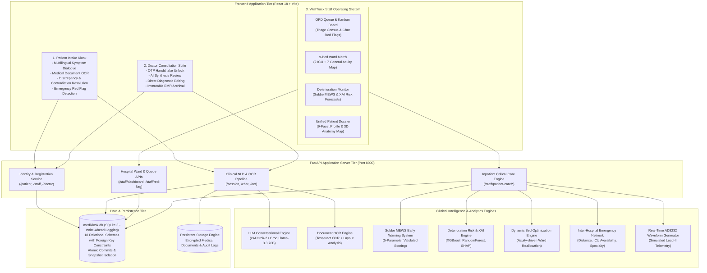

# MediKiosk
### Autonomous Clinical Intake, Emergency Triage & Inpatient Critical Care Platform

[](#)
[-success)](#)
[](#)
[](#)
[](#)
[-003B57.svg)](#)
[](#)

---

## 🏥 Executive Overview

**MediKiosk** is a full-stack, enterprise-grade hospital intelligence and clinical management system built from the ground up to solve emergency crowding, delayed triage, diagnostic inconsistencies, and uncoordinated inpatient transitions.

Operating as an integrated clinical nervous system, MediKiosk connects the entire patient continuum through a single, cohesive architecture:
1. **Self-Service Kiosk & Intake:** Conversational AI intake using advanced LLMs (xAI Grok / Groq), automated multi-document OCR, and cross-evidence contradiction detection.
2. **VitalTrack Staff Workstation:** Real-time ward operations, 9-bed acuity matrix (2 ICU + 7 General), continuous Subbe MEWS calculation, Explainable AI (XAI) deterioration risk forecasting, and auto-bed optimization.
3. **Doctor Consultation Suite:** Zero-AI-overwrite clinical authority, OTP-secured patient handoffs, and direct EMR archival.
4. **Unified 9-Facet Patient Dossier:** Interactive 3D human anatomy organ visualization, continuous multi-provenance chronological audit trail, and transfer network routing.

---

## 🏛️ End-to-End System Architecture

MediKiosk is engineered as a unified, decoupled micro-monolith with real-time bidirectional synchronization, zero cross-contamination of alert pipelines, and guaranteed sub-second response times.



---

## ⚡ Core Platform Capabilities

### 1. Autonomous Patient Intake & Triage Kiosk
- **Self-Service Check-In:** Rapid demographic intake issuing a cryptographically tracked identity (`PAT-XXXXXXXX`) with salted SHA-256 credentials.
- **Adaptive Clinical NLP Interview:** Driven by xAI Grok / Groq Llama-3.3-70B, asking targeted, symptom-specific questions (onset, provocation, quality, radiation, severity, time).
- **Conversational Red Alert Detection:** Instantly isolates life-threatening emergencies (e.g., retrosternal chest pain, sudden syncope, unilateral weakness, severe dyspnea) and triggers urgent priority tags.
- **Document OCR Extraction:** Ingests patient-submitted physical lab reports, discharge summaries, and prescriptions via Tesseract OCR.
- **Cross-Evidence Contradiction Detection:** Algorithmic verification between verbal patient statements and uploaded documentary records (e.g., patient denies penicillin allergy but previous discharge summary flags anaphylaxis).
- **OTP Verification Gate:** Generates a secure, single-use 6-digit encounter code required by physicians to unlock intake summaries during consultation.

---

### 2. VitalTrack Healthcare Staff Operating System
The administrative and clinical nerve center for triage nurses, ward coordinators, and charge staff:

#### A. Central Hospital Dashboard
- **Dynamic Census KPIs:** Instant tallies for Total Intakes, In Process, Ready for Doctor, In Consultation, and Active Critical Cases.
- **AI Recommendations Panel:** Highlights clinical suggestions (e.g., bed reallocations, oxygen cylinder redistribution, nurse staffing adjustments) with confidence metrics.
- **High-Density Recharts Analytics:** Real-time data streams displaying Patient Intake Flow, Multi-Ring Ward Utilization (General, ICU, Recovery, ER), Hourly Red Flag Ratios, and Average Ward Vitals.

#### B. OPD Queue & Kanban Triage Board
- **Dual-View Switcher:** Toggle seamlessly between an actionable Data Table and an interactive 4-stage Kanban workflow:
  $$\text{In Process} \longrightarrow \text{Ready for Doctor} \longrightarrow \text{In Consultation} \longrightarrow \text{Completed}$$
- **Independent Red Flag Acknowledgement:** Triage staff acknowledge conversational intake warnings without erasing clinical flags for doctors.

#### C. Inpatient Critical Care & Bed Acuity Matrix
- **9-Bed Ward Acuity Map:** Real-time spatial tracking of 2 ICU and 7 General beds featuring vital signs telemetry, MEWS score badges, and quick bed allocation triggers.
- **Automated Bed Optimization:** Heuristic acuity reallocation algorithm (`POST /staff/patient-care/beds/optimize`) that automatically audits ward census and escalates deteriorating general ward patients into available ICU beds.
- **Inpatient Deterioration Census Table:** Tracks length of stay (LOS), latest bedside vitals, Subbe MEWS scores, and machine learning risk probabilities with quick inspection drawers.

---

### 3. Doctor Consultation & Clinical Decision Support
- **Physician Authentication:** Secure doctor sign-in with specialization tags and active patient encounter lists.
- **Zero-AI Overwrite Policy:** The attending physician maintains full clinical authority. AI-synthesized summaries act as drafts; doctor notes, diagnoses, and prescriptions are strictly protected and can never be overwritten by AI agents.
- **Interactive EMR Record Archival:** Encounter completion commits an immutable record into `emr_records`, sealing the visit into hospital history.

---

### 4. Unified 9-Facet Patient Dossier & 3D Anatomical Map
Accessible via a single click from any queue row, bed tile, or alert card, the Dossier provides complete clinical depth:

```
┌────────────────────────────────────────────────────────────────────────┐
│                      UNIFIED CLINICAL DOSSIER                          │
├──────────────────────────────────┬─────────────────────────────────────┤
│ 1. Demographics & Intake Header  │ 6. Subbe MEWS Trajectory Audit      │
│ 2. Interactive Anatomical Model  │ 7. ML Deterioration & Explainable AI│
│ 3. Clinical Interview Dialogues  │ 8. Multidisciplinary Care Plans     │
│ 4. Document OCR & Extracted Text │ 9. Multi-Provenance Timeline        │
│ 5. Contradiction Resolutions     │    (Chronological Clinical Journey) │
└──────────────────────────────────┴─────────────────────────────────────┘
```

- **Interactive 3D Anatomical Visualization:** Organ-by-organ breakdown (Brain, Lungs, Heart, Liver, Kidneys, Gastrointestinal) dynamically reflecting clinical observations and patient complaints.
- **Multi-Provenance Timeline:** Chronologically correlates events from disparate sources (Kiosk Chat, Document Upload, Nurse Bedside Vitals, Doctor Notes) with actor attribution and timestamps.

---

## 🛡️ Decoupled Dual-Alert Architecture (Clinical Rule 9)

To eliminate alarm fatigue and protect patient safety, MediKiosk strictly isolates outpatient conversational emergency flags from inpatient physiological deterioration alerts:

| Dimension | Alert Type A: Conversational Red Flag | Alert Type B: Physiological MEWS Alert |
| :--- | :--- | :--- |
| **Originating Source** | Emergency symptoms surfaced in AI intake chat | Bedside vital signs observation meeting $\text{MEWS} \ge 4$ |
| **Data Attribute** | `sessions.red_flag` | `patient_vitals.mews_score` |
| **Clinical Domain** | Outpatient Intake & Emergency Triage | Inpatient Hospital Wards & ICU |
| **Visual Indicator** | Crimson Badge (`🚨 AI Chat Red Flag`) | Amber / Red Badge (`⚡ MEWS Critical Alert`) |
| **Resolution Action** | Staff Portal "Acknowledge" button | Bedside vital re-assessment & clinical intervention |
| **Isolation Rule** | Acknowledging chat flag **never** modifies vitals. | Normal vitals **never** dismiss conversational red flags. |

---

## 🧠 Clinical AI & Machine Learning Pipeline

### 1. Subbe Modified Early Warning Score (MEWS)
Implements the validated Subbe et al. (2001) clinical ruleset across 5 physiological parameters:
- **Systolic Blood Pressure** ($\le 70$ to $\ge 200 \text{ mmHg}$)
- **Heart Rate** ($\le 40$ to $\ge 130 \text{ bpm}$; normal range $51\text{--}100\text{ bpm} = 0$)
- **Respiratory Rate** ($\le 8$ to $\ge 30 \text{ breaths/min}$)
- **Body Temperature** ($\le 35.0^\circ\text{C}$ to $\ge 38.5^\circ\text{C}$)
- **AVPU Consciousness Level** (Alert, Verbal, Pain, Unresponsive)

> **Discharge Safety Gate:** Any inpatient with a calculated $\text{MEWS} \ge 3$ is automatically blocked from routine discharge without mandatory clinical supervisor override.

### 2. Deterioration Risk Prediction & Explainable AI (XAI)
- **Multi-Model Inference:** Ensembles Random Forest, Gradient Boosting, Support Vector Machines, and Logistic Regression to calculate 24-hour deterioration probability.
- **SHAP Feature Importance:** Translates complex model weights into transparent, bedside-actionable percentages (e.g. *Respiratory Rate contribution: 32%*, *Heart Rate anomaly: 26%*).
- **Deterministic Heuristic Safeguard:** If pre-trained weights encounter environmental inconsistencies, the system deterministically executes rule-based clinical fallbacks to ensure uninterrupted operation.

### 3. Real-Time AD8232 Waveform Oscilloscope
- Generates high-fidelity, real-time Lead-II P-Q-R-S-T cardiac vector simulations on HTML5 Canvas.
- Includes dynamic BPM telemetry, signal quality metrics, and visual arrhythmia indicators.

### 4. Emergency Inter-Hospital Transfer Network
Calculates composite destination rankings for critical patient transfers based on:
$$\text{Rank Score} = w_1 \cdot \text{Proximity} + w_2 \cdot \text{ICU Bed Availability} + w_3 \cdot \text{Required Medical Specialty}$$
Includes pre-configured partner nodes: *Apollo Clinic*, *City Diagnostics & Specialty*, and *Fortis Super Specialty Center*.

---

## 💻 Technology Stack

| Layer | Technologies |
| :--- | :--- |
| **Frontend Framework** | React 18, Vite, ES6+ Modules |
| **Styling & Design System** | Custom VitalTrack CSS System, CSS Grid & Flexbox, Lucide Icons |
| **Data Visualization** | Recharts (Area, Bar, Multi-ring Radial Gauges, Funnels, Sparklines) |
| **Backend REST API** | FastAPI, Uvicorn, Python 3.11 / 3.13 |
| **AI / LLM Providers** | xAI Grok (`grok-2-latest`) via OpenAI SDK, Groq Cloud (`llama-3.3-70b-versatile`) |
| **OCR & Computer Vision** | Tesseract OCR, Pillow (PIL), Layout Analysis |
| **Machine Learning** | Scikit-Learn, NumPy, SciPy, Joblib |
| **Database & Storage** | SQLite 3 with Write-Ahead Logging (`PRAGMA journal_mode=WAL`), File Storage |

---

## 🚀 Installation & Local Setup

### Prerequisites
- **Python 3.11+**
- **Node.js 18+ & npm 9+**
- **Tesseract OCR** (Optional, for image document text extraction)

### 1. Backend Service Setup
```bash
# Navigate to backend directory
cd backend

# Create and activate Python virtual environment
python -m venv .venv
# On Windows:
.\.venv\Scripts\Activate.ps1
# On Linux/macOS:
source .venv/bin/activate

# Install dependencies
pip install -r requirements.txt

# Configure environment variables
# Copy template and add your xAI Grok or Groq API key:
cp .env.example .env

# Initialize database schemas
python -c "import database; database.create_tables(); print('Database tables ready!')"

# Launch FastAPI backend with hot-reload
uvicorn app.main:app --host 127.0.0.1 --port 8000 --reload
```
- Interactive Swagger API Documentation: [http://127.0.0.1:8000/docs](http://127.0.0.1:8000/docs)
- Health Check: [http://127.0.0.1:8000/health](http://127.0.0.1:8000/health)

### 2. Frontend Application Setup
```bash
# Open a new terminal and navigate to Frontend
cd Frontend

# Install node packages
npm install

# Build for production verification
npm run build

# Start Vite development server
npm run dev
```
- Web Application: [http://localhost:5173](http://localhost:5173)

---

## ☁️ Cloud Deployment (Render.com)

MediKiosk includes native deployment configurations for both Render Free and Paid tiers:

1. **Deploying the Backend Web Service:**
   - **Runtime:** `Python 3`
   - **Root Directory:** `backend`
   - **Build Command:** `pip install --upgrade pip && pip install -r requirements.txt`
   - **Start Command:** `uvicorn app.main:app --host 0.0.0.0 --port $PORT`
   - **Environment Variables:**
     - `PYTHON_VERSION`: `3.11.9`
     - `DATABASE_PATH`: `medikiosk.db`
     - `UPLOADS_DIR`: `uploads`
     - `CORS_ALLOWED_ORIGINS`: `*`
     - `XAI_API_KEY`: *(Your private xAI Grok API key)*
     - `XAI_MODEL`: `grok-2-latest`

2. **Deploying the Frontend Static Site:**
   - **Root Directory:** `Frontend`
   - **Build Command:** `npm install --include=optional && npm run build`
   - **Publish Directory:** `dist`
   - **Environment Variable:** `VITE_API_BASE` set to your live backend Render URL.
   - **Rewrite Rule:** `/*` $\longrightarrow$ `/index.html`.

---

## 🔑 Demonstration Credentials

Pre-configured hospital facilities and demo accounts are ready for live demonstration:

| Facility Name | Role / Account | Email | Password | Facility ID |
| :--- | :--- | :--- | :--- | :--- |
| **MediKiosk General Hospital** | Triage Nurse / Desk Coordinator | `staff@medikiosk.com` | `password123` | `hosp-medikiosk` |
| **Apollo Clinic & Specialty** | OPD Coordinator / EMR Liaison | `staff@apollo.com` | `password123` | `hosp-apollo` |
| **City Diagnostics & Specialty**| Diagnostics Coordinator | `staff@city.com` | `password123` | `hosp-city` |

*Doctor Portal Access:* Select attending doctor from the portal dropdown (e.g., `Dr. Rajesh Gupta - Cardiology` or `Dr. Priya Sharma - General Medicine`).

---

## 🧪 Comprehensive Automated Test Suites

MediKiosk includes 6 automated validation suites comprising **131 test cases** with a verified **100% pass rate**:

```bash
cd backend

# 1. Baseline Intake & Clinical Extraction Tests (10 tests)
python test_new_features.py

# 2. Inpatient Care: Vitals, MEWS, ML Risk, Beds & Transfers (42 tests)
python test_patient_care_backend.py

# 3. Healthcare Staff Station UI Contracts & Queue Verification (12 tests)
python test_phase3_staff_dashboard.py

# 4. Unified Patient Dossier & Multi-Source Audit Timeline (28 tests)
python test_phase4_patient_data_integration.py

# 5. Master Validation Suite across Clinical Safeguards (38 tests)
python -m unittest test_phase5_comprehensive_validation.py

# 6. Database WAL Mode & Disaster Recovery Verification (1 test)
python test_backup_restore.py
```

---

## 📁 Repository Directory Structure

```
Medikiosk/
├── backend/                              # FastAPI Backend Service
│   ├── app/
│   │   ├── main.py                       # REST entrypoint, route controllers & AI providers
│   │   ├── models/                       # Pydantic schemas (patient_care_models.py)
│   │   ├── routers/                      # Specialized routers (patient_care.py)
│   │   └── services/patient_care/        # Clinical engines (mews, ml_risk, transfer, ecg)
│   ├── database.py                       # SQLite data access engine & 18 relational schemas
│   ├── medikiosk.db                      # Primary database (SQLite WAL mode)
│   ├── requirements.txt                  # Python dependencies
│   ├── .env.example                      # Backend environment template
│   └── test_*.py                         # Automated test suites
├── Frontend/                             # React 18 + Vite User Interface
│   ├── src/
│   │   ├── App.jsx                       # Application router & navigation orchestrator
│   │   ├── components/                   # StaffPortal, DoctorPortal, Kiosk, LandingShowcase
│   │   ├── components/ui/                # VitalTrack component library (KpiCard, BedTile, Drawer...)
│   │   ├── components/vital_track/       # DashboardHome, OpdQueueDashboard, AdmittedPatientsDashboard
│   │   └── components/patient_care/      # Clinical modal suite & Unified Dossier
│   ├── package.json                      # Frontend dependencies & scripts
│   └── .env.example                      # Frontend environment template
├── docs/                                 # Architectural & Technical Documentation
│   ├── FINAL_SYSTEM_ARCHITECTURE.md      # Full system architecture specification
│   ├── API_DOCUMENTATION.md              # REST API reference documentation
│   ├── USER_GUIDE_HEALTHCARE_STAFF.md    # Healthcare staff station manual
│   └── USER_GUIDE_DOCTOR.md              # Doctor consultation manual
├── render.yaml                           # Cloud deployment blueprint
└── README.md                             # Unified project documentation
```

---

## 🛡️ Clinical Disclaimers & Governance Notice

> [!WARNING]
> **Clinical Governance Notice (Rule 11):**  
> MediKiosk is designed as an intelligent clinical decision-support and workflow coordination tool. Software test execution and automated flags **DO NOT** replace bedside clinician judgment. The AD8232 ECG streaming feature is a simulated waveform generator intended for workflow demonstration.

> [!IMPORTANT]
> **Synthetic Machine Learning Training Data Notice (Rule 12):**  
> All pre-trained machine learning deterioration risk models (`RandomForest`, `GradientBoosting`, `SVM`, `LogisticRegression`) and length-of-stay estimation models were trained on synthetic cohorts. Model predictions serve as exploratory guidance and must be interpreted alongside direct physical examination.

---

## 📄 License

This project is licensed under the MIT License. See [LICENSE](LICENSE) for details.
