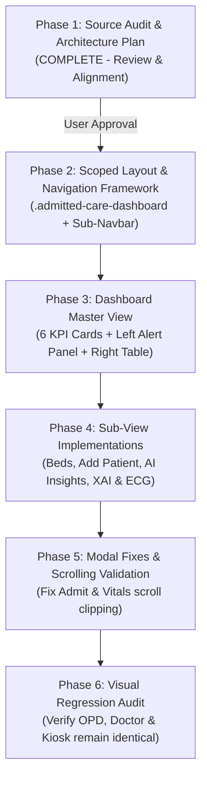

# HEALTHCARE STAFF PORTAL REDESIGN: SOURCE AUDIT AND FRONTEND RESTRUCTURING PLAN
**Document Version:** 1.0  
**Phase:** 1 (Audit, Layout Architecture & Transition Plan)  
**Target Module:** Healthcare Staff Portal → Dashboard 2 (Admitted Patient Care & Monitoring)  
**Date:** November 4, 2026  

---

## 1. Executive Summary & Objective

The MediKiosk platform currently possesses full underlying inpatient clinical monitoring and patient care capabilities (MEWS calculation, ML risk prediction, bed allocation, synthetic ECG oscilloscope simulation, care plans, and inter-hospital transfers). However, the frontend layout in the Healthcare Staff Portal (`Dashboard 2`) does not currently mirror the visual layout, visual hierarchy, navigation structure, and feature presentation of the original standalone **Patient Care System**.

The purpose of this redesign is to **restructure only the frontend presentation of Dashboard 2 (Admitted Patient Care & Monitoring)** inside `Frontend/src/components/patient_care/` so that it accurately reproduces the visual layout of the original Patient Care System, while:
1. **Preserving Dashboard 1 (OPD Patient Queue & Doctor Consultation)** completely unchanged.
2. **Preserving MediKiosk's global brand identity, color palette, typography, and navigation shell** without any global CSS leakage.
3. **Strictly segregating patient populations** between Outpatients (OPD Queue) and Inpatients (Admitted Patients).
4. **Reusing 100% of the existing integrated APIs, database tables, and backend services** without duplicate backends, duplicate databases, or synthetic data re-seeding.

---

## 2. Current Healthcare Staff Portal Structure

The current staff workstation is mounted at `Frontend/src/components/StaffPortal.jsx`.

### Structure Overview
```
StaffPortal.jsx (Root Container: .staff-portal-container)
 ├── Top Staff Bar (.staff-topbar)
 │    ├── Hospital identification & active staff profile
 │    └── 10s auto-polling indicator, Refresh button & Sign Out
 ├── Workstation View Switcher (.staff-workstation-nav)
 │    ├── Tab 1: "OPD Patient Queue & Triage" (Dashboard 1)
 │    └── Tab 2: "Inpatient Care & Physiological Monitoring" (Dashboard 2)
 └── Workstation Content Area:
      ├── IF workstationView === "opd":
      │    ├── Red-Flag Urgent Alerts Banner (.urgent-red-flags-banner)
      │    ├── OPD Census KPI Counters (Total, In Process, Ready for Dr, In Consult, Completed, Red Flag)
      │    ├── OPD Patient Queue Table & Filters
      │    └── Case Details Modal (.staff-modal-overlay)
      └── IF workstationView === "patient_care":
           └── <PatientCareModule apiBase={apiBase} currentStaff={currentStaff} />
```

---

## 3. Existing OPD Workflow & Data (Dashboard 1 — Strictly Preserved)

Dashboard 1 manages outpatient flow from initial self-registration at the MediKiosk to physician consultation.

### Populations Managed:
- Newly registered walk-in patients (`PAT-XXXXXXXX`).
- Patients engaged in AI clinical intake (`/chat`).
- Patients with completed interviews and synthesized clinical summaries.
- Patients awaiting contradiction resolution (`/contradictions`).
- Patients queued for attending physicians (`ready_for_opd`).
- Patients actively in doctor consultation (`in_consultation`).
- Completed outpatient consultations with finalized EMR records (`completed`).

### Data Preserved:
- Patient demographics, contact info, and assigned department.
- Full conversational transcript between patient and MediKiosk AI.
- Extracted text from uploaded documents (Tesseract OCR).
- Contradiction audit log (discrepancies between conversation and records).
- Conversational Red Flags (`sessions.red_flag = 1`) and staff acknowledgement status.
- Doctor consultation notes and assigned room.

> [!IMPORTANT]
> **Dashboard 1 must remain 100% visually and functionally identical.** All existing OPD patient cards, queue filters, red-flag alert buttons, and consultation status flows will remain untouched.

---

## 4. Existing Patient Care Frontend Structure (Current Dashboard 2)

Currently, `PatientCareModule.jsx` renders a single unified vertical layout:
1. **Header Banner (`.pc-header-card`):** Title, description, "Admit New Patient" button, and "Optimize Beds" button.
2. **Census Summary Strip (`.pc-census-grid`):** 6 pill cards (Total Patients, Critical MEWS, Intake Red Flags, ICU Patients, General Patients, Discharge Ready).
3. **Interactive Ward Bed Map (`.pc-bed-grid`):** 9 bed cards (2 ICU + 7 General Beds) showing bed status and occupant.
4. **Monitored Patient Registry (`.pc-patients-table`):** Table listing patients with MEWS, Red Flags, Bed Number, and action pills.
5. **Modal System:** 8 separate popups:
   - `AdmitPatientModal.jsx`
   - `BedManagementModal.jsx`
   - `CarePlansModal.jsx`
   - `ECGTelemetryModal.jsx`
   - `TransferNetworkModal.jsx`
   - `UnifiedPatientProfileModal.jsx`
   - `VitalRecorderModal.jsx`
   - `XAIRiskModal.jsx`

---

## 5. Original Patient Care Reference Dashboard Analysis

Based on the reference standalone project (`reference_patient_care/` from `Patient-care-main.zip`), the original Patient Care System features a multi-page / sub-tab navigation layout:

```
Original Patient Care Layout Architecture:
┌────────────────────────────────────────────────────────────────────────────────────────┐
│ NAVBAR: [🏥 AI Patient Care System] [Dashboard] [Bed Management] [Add Patient] [AI Insights] [XAI & ML] │
├────────────────────────────────────────────────────────────────────────────────────────┤
│ SIX STATISTIC KPI CARDS (Colored Bootstrap Cards):                                      │
│ [ Total Beds (Blue) ] [ Available Beds (Green) ] [ Critical Patients (Red) ]          │
│ [ Occupied Beds (Yellow) ] [ High Risk Patients (Cyan) ] [ Total Patients (Dark) ]     │
├──────────────────────────────────────┬─────────────────────────────────────────────────┤
│ LEFT COLUMN (col-lg-4):              │ RIGHT COLUMN (col-lg-8):                        │
│ 1. 🚨 Critical Alerts - XAI Explan.   │ 📋 Current Admitted Patients Table              │
│    - Patient name, MEWS, Risk %      │    - Search input & Ward/Status dropdown filter │
│    - Needs ICU upgrade tag           │    - Columns: Name, Age, Triage, Condition, Bed,│
│    - Why this alert triggered (text) │      Priority (progress bar), Risk, MEWS, Actions│
│    - "View Details" & "Upgrade to ICU"│    - Action buttons: [👁️ View] [🩺 Vitals] [⚡ ICU]│
│ 2. 🛏️ Smart Bed Management Card      │                                                 │
│    - ICU vs General count            │                                                 │
│    - "Run Bed Optimization Now" btn  │                                                 │
│ 3. ⚡ Quick Actions Card              │                                                 │
│    - Add Patient, XAI & ML, AI Insights│                                               │
└──────────────────────────────────────┴─────────────────────────────────────────────────┘
```

### Reference Views:
1. **Dashboard View (`dashboard.html`):** The master 6-KPI split-screen layout described above.
2. **Bed Management View (`beds_management.html`):** Ward navigation tabs (`All Wards`, `ICU Ward`, `Ward A`, `Ward B`, `Ward C`), interactive bed cards grid, occupancy percentages.
3. **Add Patient View (`add_patient.html`):** Inpatient admission form with triage priority, comorbidities, chief complaint, estimated LOS.
4. **AI Insights View (`ai_insights.html`):** 6-hour capacity forecasting (predicted admissions, discharges, ICU demand), peak hours, high-risk deterioration monitor.
5. **XAI & ML View (`xai_dashboard.html`):** Real-time AD8232 simulated ECG oscilloscope (Connect/Disconnect, Live Sweep Chart, HR, Signal Quality, Arrhythmia), ML Model comparison table (Random Forest, Gradient Boosting, SVM, Logistic Regression).
6. **Patient Detail View (`patient_detail.html`):** Patient demographics, bed info, historical vitals trend charts, MEWS breakdown, personalized care plans, and hospital transfer recommendation cards.

---

## 6. Side-by-Side Feature Comparison

| Feature / UI Element | Original Patient Care System | Current MediKiosk Implementation | Redesign Plan for Dashboard 2 |
| :--- | :--- | :--- | :--- |
| **Top Sub-Navigation** | Blue navbar with 5 tabs (Dashboard, Beds, Add Patient, AI Insights, XAI & ML) | No sub-nav; single scrolling page | **Implement scoped sub-nav** reproducing the 5 tabs within Dashboard 2 |
| **KPI Statistics** | 6 distinct colored cards (Blue, Green, Red, Yellow, Cyan, Dark) | 6 flat inline metric pills | **Recreate the 6 colored KPI cards** with exact icons and counts |
| **Left Sidebar** | Critical Alerts with XAI explanations, Smart Bed actions, Quick Actions | Alerts mixed into top census banner | **Recreate Left Sidebar** with XAI alert cards and bed optimization actions |
| **Patient Table** | Right-hand side table with Priority progress bar, Risk %, MEWS badge, Action buttons | Full-width bottom table with flat design | **Recreate Right-side Table** with original column set, priority bars, and inline buttons |
| **Patient Population** | Admitted patients only | Currently displays all patients with OPD sessions | **Strictly filter to admitted patients only** |
| **Bed Management** | Dedicated view with ward pills & status color cards | Embedded grid inside main page | **Move to dedicated "Bed Management" sub-tab** with ward filter pills |
| **Add Patient** | Dedicated form tab for admission | Popup modal only | **Provide dedicated "Add Patient" sub-tab** while preserving modal trigger |
| **AI Insights** | Dedicated page with capacity forecasting & peak hours | Not surfaced as a dedicated view | **Provide dedicated "AI Insights" sub-tab** using existing capacity service |
| **XAI & ECG Monitoring** | Dedicated dashboard with live canvas & model performance table | Popup modals (`XAIRiskModal`, `ECGTelemetryModal`) | **Provide dedicated "XAI & ML" sub-tab** with integrated ECG canvas and model table |
| **Patient Detail View** | Dedicated 2-column detail page | Popup modal (`UnifiedPatientProfileModal`) | **Integrate full detail view / modal trigger** seamlessly |

---

## 7. Patient Segregation Rules (OPD vs Admitted Inpatients)

To satisfy clinical governance and avoid data pollution between outpatient triage and inpatient wards:

```
┌────────────────────────────────────────────────────────────────────────────────────────┐
│                                   CANONICAL PATIENT DATABASE                           │
│                                           (patients)                                   │
└───────────────────────────────────────────┬────────────────────────────────────────────┘
                                            │
                    ┌───────────────────────┴───────────────────────┐
                    ▼                                               ▼
     [ DASHBOARD 1: OPD / TRIAGE ]                   [ DASHBOARD 2: ADMITTED INPATIENTS ]
     - Has active session in `sessions`              - Has active bed in `patient_beds` (status = occupied)
     - `patient_beds.bed_number IS NULL`             - OR explicitly admitted via `/admit`
     - Status: `in_progress`, `ready_for_opd`,        - Status: `admitted`, `assigned_bed`, `inpatient`
       `in_consultation`, `completed`                 - Monitored bedside vitals & MEWS
     - Ordinary outpatients waiting for doctor        - EXCLUDES ordinary OPD walk-ins
```

### Exact Filter Logic:
1. **Dashboard 1 (OPD Queue):**
   - Displays patients returned by `GET /staff/patients?hospital_id=...`.
   - Filters out any patient whose current admission is active in an inpatient bed.
2. **Dashboard 2 (Admitted Patients):**
   - Displays patients returned by `GET /staff/patient-care/patients?hospital_id=...`.
   - **Frontend Guard:** Filter `patients.filter(p => Boolean(p.bed_number) || p.is_admitted)`.
   - Any patient in OPD triage without an admission record is excluded.

---

## 8. Frontend Components to Modify & Files to Keep Untouched

### Frontend Files to Modify:
1. `Frontend/src/components/patient_care/PatientCareModule.jsx`
   - Reorganize into a sub-routed dashboard container with 5 views:
     - `Dashboard` (6 KPIs, Left: Critical Alerts & Bed Management, Right: Current Admitted Patients Table).
     - `Bed Management` (Ward filter pills, bed cards grid, ICU elevation, bed assignment).
     - `Add Patient` (Direct admission & bed allocation form).
     - `AI Insights` (Capacity forecasting, peak hours, high-risk patient surveillance).
     - `XAI & ML` (Live AD8232 ECG simulation stream & ML model performance evaluation).
2. `Frontend/src/components/patient_care/patient_care.css`
   - Add scoped CSS rules under `.admitted-care-dashboard` recreating the reference layout (cards, colored headers, left-right split layout, progress bars, alert cards).
   - Fix the modal flexbox scrolling bug so `.pc-modal-window` and nested forms scroll properly.
3. `Frontend/src/components/patient_care/AdmitPatientModal.jsx`
   - Fix the form overflow issue by ensuring the form body has `overflow-y: auto; max-height: calc(90vh - 140px);`.
4. `Frontend/src/components/patient_care/VitalRecorderModal.jsx`
   - Ensure the `<form>` element has `display: flex; flex-direction: column; height: 100%; min-height: 0;` so the footer buttons remain visible and the body scrolls properly.

### Files That Must Remain Untouched:
- `Frontend/src/App.jsx` — Untouched.
- `Frontend/src/App.css` — Untouched.
- `Frontend/src/index.css` — Untouched.
- `Frontend/src/components/PortalHeader.jsx` — Untouched.
- `Frontend/src/components/PatientWelcome.jsx` — Untouched.
- `Frontend/src/components/PatientAuth.jsx` — Untouched.
- `Frontend/src/components/DoctorPortal.jsx` — Untouched.
- `Frontend/src/components/DoctorPlaceholder.jsx` — Untouched.
- `Frontend/src/components/ExternalEMRConsent.jsx` — Untouched.
- `Frontend/src/components/MedicalTimeline.jsx` — Untouched.
- `backend/**` — All backend services, models, and databases remain untouched.

---

## 9. Scoped CSS Strategy (Zero Leakage into MediKiosk)

All new styling for Dashboard 2 will be strictly encapsulated under the parent selector:
```css
/* Scoped exclusively to the Admitted Patient Care Dashboard */
.admitted-care-dashboard {
  /* Internal CSS variables derived from reference theme */
  --ref-blue: #0d6efd;
  --ref-green: #198754;
  --ref-red: #dc3545;
  --ref-yellow: #ffc107;
  --ref-cyan: #0dcaf0;
  --ref-dark: #212529;
  --ref-card-bg: #ffffff;
  --ref-border: rgba(0, 0, 0, 0.125);
}

.admitted-care-dashboard .ref-navbar { ... }
.admitted-care-dashboard .ref-kpi-card { ... }
.admitted-care-dashboard .ref-alerts-panel { ... }
.admitted-care-dashboard .ref-patients-table { ... }
```
This guarantees that no styles bleed into:
- The global MediKiosk shell
- The OPD dashboard (Dashboard 1)
- The Doctor Portal
- The Patient Kiosk

---

## 10. Phase-Wise UI Redesign Implementation Plan



### Detailed Steps:
- **Phase 2:** Implement `.admitted-care-dashboard` wrapper and the 5-tab sub-navigation (`Dashboard`, `Bed Management`, `Add Patient`, `AI Insights`, `XAI & ML`).
- **Phase 3:** Recreate the reference `Dashboard` view:
  - 6 colored KPI cards with real-time statistics from `counts` and `beds`.
  - Left column: Critical Alerts list with XAI explanations, Smart Bed Management, and Quick Actions.
  - Right column: Admitted Patients table with search, ward filtering, ESI badges, Priority score progress bar, Risk %, MEWS score, and action triggers.
- **Phase 4:** Recreate the dedicated sub-views:
  - `Bed Management`: Interactive ward bed cards and allocation.
  - `Add Patient`: Integrated inpatient admission and bed allocation form.
  - `AI Insights`: Capacity forecasting, peak hours, and high-risk patient surveillance.
  - `XAI & ML`: Live AD8232 ECG oscilloscope canvas, connect/disconnect controls, and model performance metrics.
- **Phase 5:** Resolve modal scrolling clipping on `AdmitPatientModal.jsx` and `VitalRecorderModal.jsx`.
- **Phase 6:** Validate that OPD queue, Doctor Portal, and Patient Kiosk remain completely untouched and bug-free.

---

## 11. Verification Checklist & Acceptance Criteria

- [ ] **Patient Population Segregation:** Dashboard 1 displays only OPD outpatients; Dashboard 2 displays only admitted inpatients.
- [ ] **Visual Reproduction:** Dashboard 2 closely mirrors the reference Patient Care layout (sub-nav, 6 KPI cards, left alerts panel, right patient table).
- [ ] **Zero Global CSS Leakage:** OPD dashboard, Doctor Portal, and Patient Kiosk retain exact existing MediKiosk styling.
- [ ] **Functional Parity:** MEWS calculation, XAI risk explanations, bed assignment, ICU upgrades, ECG telemetry, care plans, and transfers operate smoothly.
- [ ] **Scrolling Fixed:** All modals (especially admission and vitals recording) scroll properly on all screen resolutions with buttons always accessible.
- [ ] **No Backend Duplication:** No Flask backend copied, no new database tables created, no changes to backend logic.

